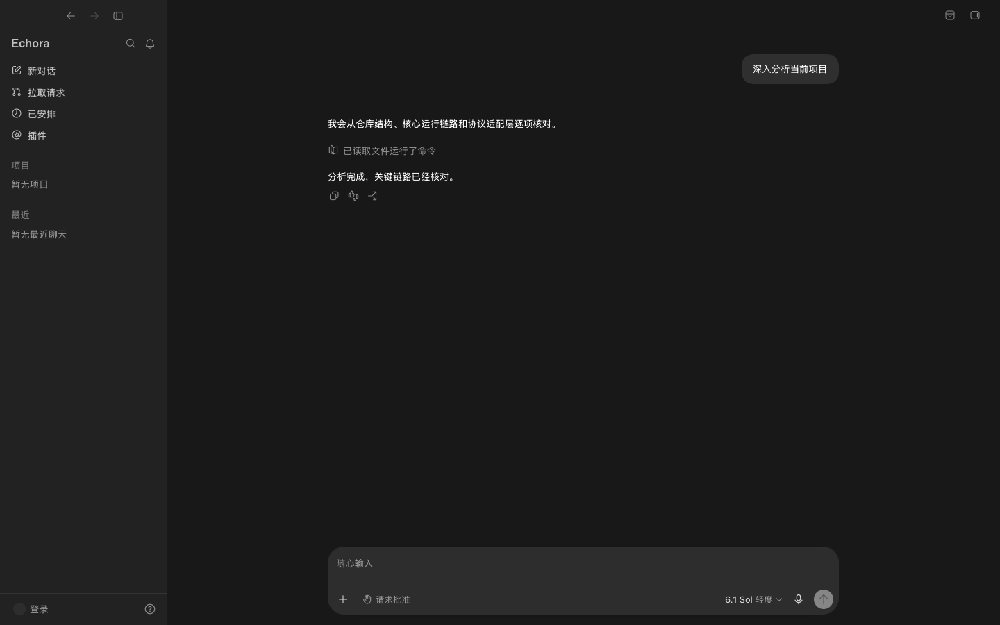
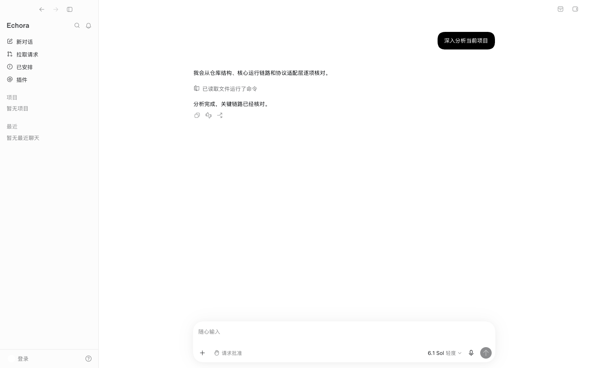
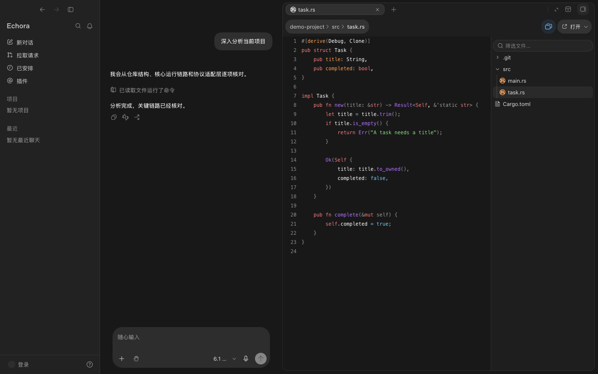
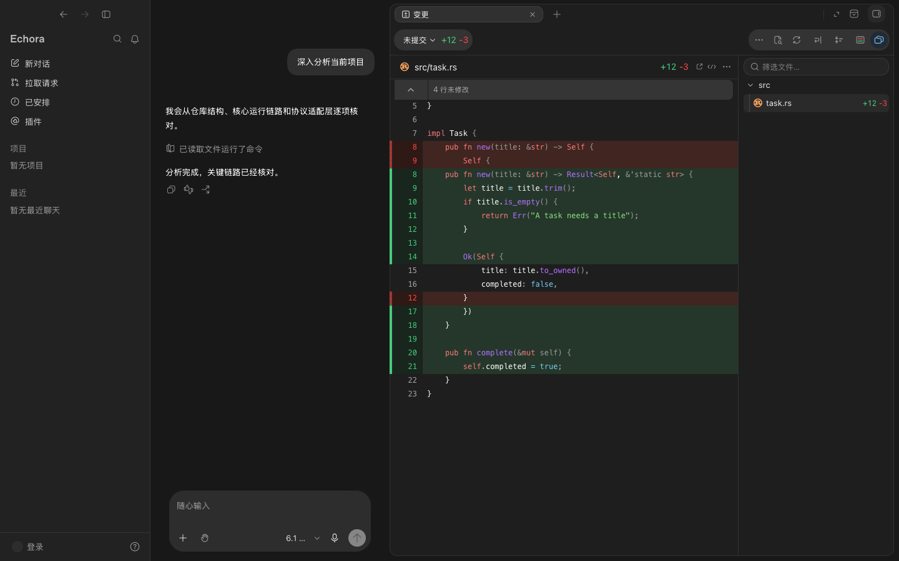
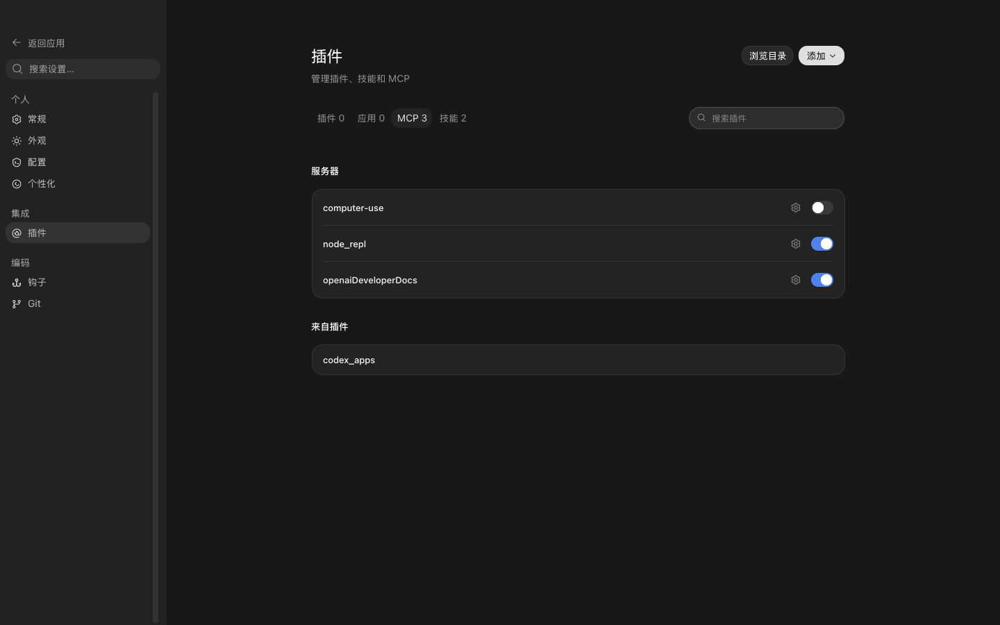
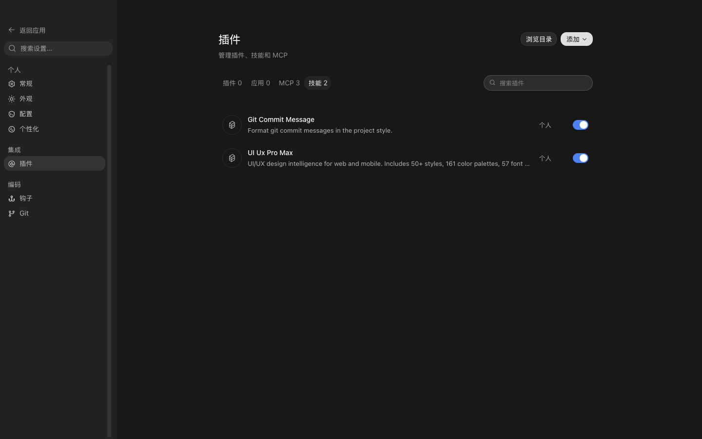

<h1 align="center">Echora</h1>

<p align="center"><strong>A native desktop workspace for working with Codex.</strong></p>
<p align="center">Rust + GPUI · Powered by Codex app-server</p>
<p align="center"><strong>English</strong> · <a href="README.zh-CN.md">简体中文</a></p>

Echora brings conversations, local projects, files, terminals, web browsing, and code review into one desktop application. Its interface draws on the ChatGPT app, with a conversation at the center and the tools you need alongside it.

Echora is an independent application in early development. It currently connects to Codex through the locally installed Codex CLI.



<details>
<summary>Light theme</summary>



</details>

*Screenshots were captured from the current native build with example conversations, files, and server inventories. Some interface labels still use the Codex name.*

## Work with your agent

Start a conversation in a local project, attach context, and follow the agent's replies and tool activity as they arrive. Plans, commands, searches, and file changes appear in the conversation, while approval cards let you inspect actions that need permission.

- Add files, folders, images, skills, plugins, local chats, and pages from the in-app browser as context. Drop files or macOS screenshot thumbnails anywhere in the conversation to attach them; unsaved screenshots are received locally and shown as image previews. Image previews fit the available window area without a bottom zoom bar. Open an unsent image attachment and choose **Mark up** to add strokes, shapes, or text, with erasing and undo/redo. Adjust stroke width by clicking or dragging the left slider, scrolling over it, or focusing it and using the arrow keys; saving replaces that draft attachment at its original image size without changing the source file.
- Choose the permission options exposed by your Codex configuration. New chats remember your last confirmed choice; permission options refresh automatically after a backend reconnect.
- Send new instructions while the agent works, or queue follow-ups for later.
- Return to an unsent draft with **New chat** in the same project or section. Its prompt and attachments stay in memory while switching chats; titlebar Back/Forward also restores the original conversation.
- Use plan mode, set a goal, or start a code review from the slash menu when supported by the backend.
- Stop a turn, resume an interrupted conversation, search its messages, and jump between prompts.
- Follow Computer Use in the upper-right window preview, with the current action, progress, and recent operations. macOS live previews use Screen Recording access; without it, the card shows the latest tool capture and its source. **Take over** stops the agent, waits for confirmation, then focuses the selected app. Collapsing the card or leaving the chat stops live capture.
- Open a temporary side chat to explore a separate question alongside the main conversation.

## Keep projects and conversations organized

Create local projects from existing folders, or create a new Git workspace. Choose a project and local checkout or new worktree before sending the first message.

The sidebar keeps projects and conversations within reach. Search, rename, pin, archive, delete, or move chats, and organize them into custom sections. The activity view brings together running chats, requests waiting for your attention, and unread results. Switching chats keeps background work running.

## Use tools beside the conversation

The right panel holds multiple tabs, so you can keep a file, terminal, browser page, and diff open together. Drag tabs to reorder them or expand the selected tool for more space.

| Tool | What you can do |
|---|---|
| **Files** | Browse and search local files, edit text with autosave, preview Markdown and images, and follow file links to a specific line. Markdown previews render HTML headings, aligned paragraphs, emphasis, links, and expandable details; relative links and images resolve beside the document. Scripts and embedded applications do not run. |
| **Terminal** | Run a local shell in the conversation's working directory, with multiple tabs, scrollback, selection, and clipboard support. |
| **Browser** | Browse pages in the embedded WebKit browser, use address and history suggestions, search within a page, manage downloads, and attach page content to a chat. |
| **Changes** | Review Git diffs in unified or split view, add line comments, stage or unstage changes, revert files or hunks, commit, create branches, push, and create pull requests. |
| **Side chat** | Explore a question in a temporary conversation with its own input, permissions, and stop control. |

The Environment panel provides quick access to the working location, branches, Git actions, attached pull requests, local servers, and background terminals. A separate Pull requests page lets you browse and filter GitHub pull requests, read activity and checks, inspect commits and diffs, and comment on code.

<details>
<summary>See the file editor and Git changes</summary>

**Local file browsing and editing**



**Git diff review**



</details>

## Make it your workspace

Echora supports light and dark themes, plus English, Simplified Chinese, and automatic language detection. Change the interface language in **Settings → General → Language**.

The sidebar **Plugins** entry opens a dedicated directory with Public, Personal, and Installed views, live search, categorized entries, plugin details, and confirmed install/uninstall actions. The Skills tab reads the agent’s available skills. Catalogs, artwork, permissions, loading states, and errors come from Codex app-server; ChatGPT-only catalogs and private services are not substituted. Returning to a chat restores its draft and panels.

Settings also provides access to supported Codex preferences, skills, plugins, MCP server status and OAuth login, hooks, experimental features, and memory controls. Available features depend on the connected account, Codex version, and configuration.

<details>
<summary>See MCP and skills management</summary>

**MCP server status**



**Skills inventory**



</details>

## Get started

The current development and interactive verification platform is **macOS**. To build and run the app, install:

- The Rust toolchain specified in [rust-toolchain.toml](rust-toolchain.toml), currently **1.97.1**.
- Xcode and its **Metal Toolchain** component, with Xcode selected as the active developer directory.
- Codex CLI on `PATH`, configured and ready to use. The current integration baseline is **codex-cli 0.158.0**.
- Git for repository features, and an authenticated GitHub CLI (`gh`) for pull request features.

```bash
git clone https://github.com/rita152/Echora.git
cd Echora
cargo run --locked --release -- --theme=dark
```

If the Metal compiler is missing, install and verify it before building:

```bash
xcodebuild -downloadComponent MetalToolchain
xcrun --sdk macosx metal --version
```

Use `--theme=light` for the light theme. Add `--language=en`, `--language=zh-CN`, or `--language=auto` to choose the interface language for one launch. Settings saves your language preference for future launches.

Download development previews from [GitHub Releases](https://github.com/rita152/Echora/releases):

| Platform | Installer | Installation |
| --- | --- | --- |
| macOS Apple Silicon (arm64) | `Echora-<version>-macos-arm64.dmg` | Open the disk image and drag Echora into Applications. |
| Windows x86_64 | `Echora-<version>-windows-x86_64-setup.exe` | Run Setup. Installs for the current user with a Start menu entry and an uninstaller. |
| Linux x86_64, Ubuntu 24.04 or a compatible newer distribution | `Echora-<version>-linux-amd64.deb` | Open with your package manager, or run `sudo apt install ./Echora-<version>-linux-amd64.deb`. Launch Echora from the application menu. |

Installers include application assets; Windows also includes the app-local MSVC runtime. Codex CLI must still be installed and configured separately. Development installers do not have trusted code signatures or macOS notarization, so the operating system may require approval before opening them. Interactive verification is currently limited to macOS; CI checks package installation, resource discovery, and removal on the corresponding runners, without testing the full Windows/Linux GUI.

The `.tar.gz` downloads are portable executable-and-assets archives, not installers; keep the executable beside its `assets/` directory. The executable is currently named `gpui-chat-clone`. `SHA256SUMS` covers all installers and portable archives. GitHub's **Source code** downloads contain source, not an installed app. Main-branch and pull-request builds remain available for 14 days on the [Actions page](https://github.com/rita152/Echora/actions/workflows/release.yml).

Performance diagnostics are opt-in: set `ECHORA_PERF_LOG=/tmp/echora-frames.jsonl` when launching Echora, then run `python3 scripts/summarize_performance.py /tmp/echora-frames.jsonl`. The JSONL records CPU frame phases, viewport/DPR, scroll delivery to draw completion, and invalidation/rebuild sources without chat or patch content. It does not measure physical display presentation or input-device latency. `--print-diagnostics` includes the build commit and a dirty-tree marker.

### Publishing a version

Versions follow SemVer: `v0.1.0-alpha.1`, `v0.1.0-alpha.2`, then beta/rc previews as needed, and `v0.1.0` for a stable release. Any version with a prerelease suffix is automatically marked **Pre-release** on GitHub and is not marked Latest.

Update the root package version in `Cargo.toml` and its entry in `Cargo.lock`, commit and push the change, then push the matching `v` tag (for example, `git tag v0.1.0-alpha.2` followed by `git push origin v0.1.0-alpha.2`). The workflow validates the version, builds all three platforms, packages and checks native installers, and creates a GitHub Release with all downloads and checksums only after every job succeeds. Publishing a release through GitHub's UI also triggers builds and attaches the same assets; its tag must match the version in the tagged source. To retry a failed release build, rerun the workflow. To rebuild an existing release with updated packaging tools, manually dispatch the workflow from `main` with `release_tag` set to the existing tag (for example, `gh workflow run release.yml --ref main -f release_tag=v0.1.0-alpha.1`). Application source and assets come from that tag; packaging tools come from the workflow commit. This updates release assets without moving the tag.

## Current scope

- **Codex is the only integrated agent.** Echora starts the local Codex app-server and uses its configuration and conversation history.
- **The ChatGPT interaction experience is only partly implemented.** Some navigation and settings entries remain placeholders; scheduled tasks, remote hosts, and ChatGPT cloud workflows are not connected.
- **The browser is for browsing and sharing page context.** Agent control of the embedded browser and Chrome extensions are not supported.
- **Some state is temporary.** Terminal sessions and side chats end when the app exits. Activity indicators reflect turns observed by Echora's own connection; work running in another client may not appear as active here.

Echora is not an official OpenAI product. Detailed backend coverage and compatibility notes are maintained in the [Codex app-server integration reference](docs/APP_SERVER_INTEGRATION.md).
